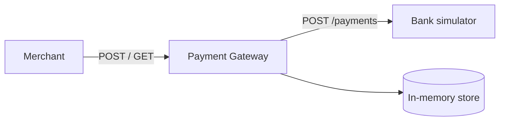
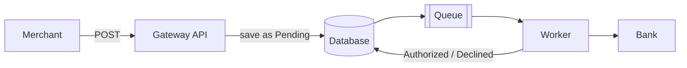

# 01 – Requirements, design decisions and assumptions

This is the baseline for the payment gateway. It records what we are building, the decisions that shape the design, and the assumptions where the brief leaves room for interpretation. Later documents in this folder go deeper on individual topics.

## Scope

A merchant-facing API that can:

1. **Process a payment.** It validates the request, forwards it to the acquiring bank (a Mountebank simulator) and returns the outcome.
2. **Retrieve a payment.** It returns a previously processed payment by its id, for reconciliation and reporting.

The gateway is the only component we build. The shopper, the merchant's checkout and the acquiring bank are outside it.

## Requirements checklist

Items are ticked once they are implemented and covered by a test.

### Processing a payment
- [x] A merchant can process a payment and receive one of:
  - **Authorized**: the acquiring bank authorised the payment
  - **Declined**: the acquiring bank declined the payment
  - **Rejected**: the request was invalid, no payment was created, and the bank was not called
- [x] Card number: required, 14–19 characters, numeric only
- [x] Expiry month: required, 1–12
- [x] Expiry year: required, in the future
- [x] Expiry month and year together are in the future
- [x] Currency: required, 3 characters, ISO 4217, validated against no more than 3 currency codes
- [x] Amount: required, integer, in the minor currency unit (0.01 USD = `1`, 10.50 USD = `1050`)
- [x] CVV: required, 3–4 characters, numeric only
- [x] The response includes: id, status (Authorized / Declined), the last four card digits (never the full number), expiry month, expiry year, currency, amount

### Retrieving a payment
- [x] A merchant can retrieve a previous payment by its id
- [x] The response includes the same fields: id, status, last four card digits, expiry month, expiry year, currency, amount

### Acquiring bank integration
- [x] `POST /payments` on the simulator with `card_number`, `expiry_date` (`MM/YYYY`), `currency`, `amount`, `cvv`
- [x] The response fields `authorized` and `authorization_code` are mapped
- [x] The simulator's behaviour is handled: odd last digit → authorised, even → declined, `0` → `503`, missing field → `400`

### Storage
- [x] No real database. The in-memory repository from the template stands in for storage.

### Documentation
- [ ] Key design considerations and assumptions are documented (this folder, plus the root README)

### Implementation considerations
- [x] Compiles
- [ ] Covered by automated tests
- [ ] Simple and maintainable, not over-engineered
- [ ] API design and architecture focus on the functional requirements

### Additional non-functional requirements
These aren't in the brief. They are the properties a payment system needs, so we hold ourselves to them.
- [x] Asynchronous: non-blocking I/O, async end to end
- [x] Idempotent: a retried or duplicated request never charges the shopper twice. The one exception is a bank timeout, whose outcome is unknown; see document 02.
- [x] Production evolution to a queue-based design is documented
- [x] Runs in Docker (gateway + bank simulator via docker compose); see document 03
- [x] Observable: structured logs, health check, traces and metrics; see document 03

## Design as built

What happens to a `POST /api/payments`:

| Situation | Bank called? | Stored? | Response |
|---|---|---|---|
| Request is invalid | No | No | `400` Rejected |
| Same `Idempotency-Key` and body as an earlier request | No | — | The original response |
| Bank authorises | Yes | Yes | `201` Authorized |
| Bank declines | Yes | Yes | `201` Declined |
| Bank unavailable (503 or timeout) | Yes | No | `502` |

`GET /api/payments/{id}` returns `200` with the payment, or `404` if the id is unknown.

## Key design decisions

### 1. Synchronous contract, asynchronous implementation
The brief says the payment response carries the outcome, Authorized or Declined. So `POST` waits for the bank and returns the final status. Everything on that path is `async`/`await`, so no thread is blocked while the bank responds and the service still scales under load.

A fully queue-based design was considered: accept with `202`, process in the background, and have the merchant poll. It was rejected for this exercise. It would change the contract the brief defines, add a `Pending` status the brief doesn't have, and add moving parts the requirements don't need. It is the right shape for production, so it is described under [Production evolution](#production-evolution).

### 2. Idempotency: never charge the shopper twice
Merchants retry. Networks time out, users double-click, and a merchant can't tell "the request was lost" from "the response was lost". Without protection, a retry is a second charge.

The merchant may send an `Idempotency-Key` header:
- The first request with a key is processed normally.
- A repeat with the same key and the same body returns the original result **without calling the bank again**. This also holds if the repeat arrives while the first request is still in flight.
- A repeat with the same key but a different body returns `422`. The key has already been used for a different payment.

Details are in [02-idempotency-and-failure-handling.md](02-idempotency-and-failure-handling.md).

### 3. No automatic retries to the bank
Retrying a failed call is a common resilience pattern, but it is unsafe here. The simulator's API takes no idempotency key, so the gateway can't tell the bank "this is the same payment as before". A retry after a timeout could create a second authorisation. The gateway fails fast and leaves the retry decision to the merchant, whose idempotency key makes that retry safe on our side.

### 4. Bank failures return 502 and store nothing
If the bank returns `503`, times out or responds unexpectedly, the gateway returns `502 Bad Gateway` with a ProblemDetails body. `502` says the problem is upstream of a healthy gateway. No payment is stored, because there is no outcome to record, and the idempotency key is released so the merchant can retry.

The bank client turns every failure into one `BankUnavailableException`: a non-success status, a refused connection, a timeout (configured as `BankSimulator:Timeout`, 10 seconds by default) or an unreadable body. The controller handles that single type.

The merchant disconnecting does **not** cancel the bank call. If it did, the bank might authorise the payment while the gateway threw the answer away. Letting the call finish means the outcome is always recorded. The timeout still bounds how long it can take.

### 5. Card data handling
- The full card number and CVV are used only to call the bank. They are **never stored, returned or logged**.
- The stored payment and every response hold only the last four digits.
- Card number, CVV and last four are **strings**, not integers. They are identifiers, not quantities. As integers, leading zeros would be lost (`0123` would become `123`) and a 19-digit card number would overflow.

### 6. Validation uses the framework
Request rules are declared with built-in DataAnnotations on the request model. The one cross-field rule (expiry month and year in the future) is implemented with `IValidatableObject`. `[ApiController]` turns failures into a `400` before the controller runs, which is what guarantees a Rejected request never reaches the bank. No validation library is added, because the rules are simple enough that the framework covers them.

### 7. Storage
Storage is the in-memory `PaymentsRepository` from the template. Its lookup returns `null` for an unknown id, which the controller turns into `404`.

Requests are handled in parallel, so `Add` and `Get` take a lock around the shared `List`. Without it, two payments saved at the same moment can corrupt the list. A test adding 10,000 payments in parallel lost most of them before the lock was added.

A queue wouldn't be the right fix. The problem is concurrent access to an unsafe collection, and that happens whatever the API style. In production, the database handles concurrent writes. A queue is there for durability and load, not thread-safety.

### 8. The template's structure is kept
The template's layout is kept so the changes are easy to review against the original:
- `PaymentsRepository` stays in `Services/` and stores the response model.
- `PaymentStatus` stays in `Enums/`.
- Both response classes are kept.

Fixes are made only where something was wrong, such as the card number, CVV and last four being integers.

The template is treated as a starting skeleton, not a published API, so there are no existing integrations to keep compatible. Nothing could have integrated with it: there was no POST endpoint, so GET could never return a payment. Its signatures are still kept wherever possible. Three things change because the brief requires them:

| Change | Why |
|---|---|
| The request carries `CardNumber` instead of `CardNumberLastFour` | The bank needs the full card number, and the brief lists it as a request field |
| `CardNumberLastFour` in responses is a string, not a number | As a number, a card ending `0123` would read as `123` |
| `Status` is serialised as text (`"Declined"`), not a number (`1`) | The brief defines the status values as text |

In a live API, a type change like this would go out as a new version rather than in place.

In production the structure would change:

| Kept for the exercise | Production approach |
|---|---|
| The repository stores `PostPaymentResponse`, the API contract | A domain model is stored and mapped to responses, so storage and the API can change independently |
| A concrete `PaymentsRepository` class | An interface such as `IPaymentsRepository`, with async methods, so a real database can replace it without changing callers |
| A `List<T>` behind a lock, searched one item at a time | A database with an index on the payment id |
| The bank's `authorization_code` isn't stored, because the stored model is the response contract and has no field for it | Stored with the payment for reconciliation with the bank, but never returned to the merchant |
| `GetPaymentResponse` and `PostPaymentResponse` have identical fields | Kept as two types so each contract can change on its own |

### 9. Runtime
The template targeted .NET 8, which reached end of support on 10 November 2026. The solution targets **.NET 10**, the current long-term-support release. No code changes were needed.

The upgrade also turned on NuGet's check of indirect dependencies for known vulnerabilities, which .NET 8 projects don't run by default. It flagged two packages that were in the template, and both were updated:
- Swashbuckle 6.2.3 (moderate)
- Newtonsoft.Json 9.0.1, pulled in by the old test SDK (high)

## Assumptions

| Area | Assumption |
|---|---|
| Rejected response | `400 Bad Request` with a `ValidationProblemDetails` body listing each failed field, plus `"paymentStatus": "Rejected"`. It isn't called `status`, because ProblemDetails already uses `status` for the HTTP status code. Nothing is stored, so a rejected payment has no id and can't be retrieved. |
| Currencies | `GBP`, `USD` and `EUR`, upper-case only. The brief asks for no more than three codes. |
| Amount | Must be greater than zero. A zero or negative payment has no meaning. |
| Expiry | A card is valid until the end of its expiry month, so the current month is accepted. "Now" is UTC and comes from an injected `TimeProvider`, so tests can control it. |
| Expiry year | A four-digit year, for example `2027`. |
| Field types | `expiryMonth`, `expiryYear` and `amount` are JSON numbers. ASP.NET's default JSON settings also accept a numeric string such as `"04"`, which is kept because the value is still validated. A non-numeric value such as `"April"` is rejected. Card number and CVV are strings. |
| Bank failure | `503`, a timeout or an unexpected response all map to `502`. No payment is stored. |
| Idempotency-Key | Optional. Without it a request is always processed as new. Keys are held in memory for the lifetime of the process, shared by all merchants, and never expire. See document 02 for the production approach. |
| Retrieving | An unknown id returns `404`. |
| Authentication | Out of scope. All callers are treated as one merchant. |

## Out of scope, and what production would need

| Not built | Production approach |
|---|---|
| Merchant authentication | API keys or OAuth client credentials. Payments and idempotency keys are scoped per merchant. |
| Persistent storage | A database. The payment and its idempotency record are written in one transaction. |
| PCI-compliant card handling | Card data is tokenised by a PCI-scoped vault. The gateway handles tokens, not card numbers. |
| Multi-instance idempotency | Keys are stored in the shared database or a distributed cache with expiry, not in process memory. |
| Unknown bank outcomes | Reconciliation against the bank's records when a call times out after the bank may have acted. See document 02. |

## Production evolution

At production scale the bank call moves off the request path. The merchant gets an immediate, durable acknowledgement, and the outcome follows by webhook or polling:

1. The API saves the payment as `Pending` and returns `202 Accepted` straight away.
2. A worker takes it from the queue, calls the bank and records the outcome. The merchant then gets the outcome by webhook or by polling `GET`.

This needs three supporting pieces:
- **An outbox:** the payment and its queue message are written in one database transaction, so a payment can't be saved without also being queued.
- **Bank-side idempotency keys**, so the worker can retry safely.
- **A reconciliation job** for payments whose outcome is unknown after a timeout.
