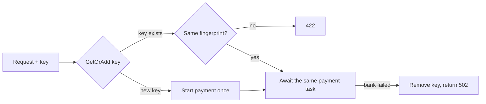

# 02 – Idempotency and failure handling

How the gateway makes sure a shopper is never charged twice for the same payment, and what it does when the bank fails.

## The problem

A merchant can't always tell whether a payment went through. If their request times out, either the request was lost or the response was. Without protection, a retry looks like a new payment and charges the card again. A double-click or a retrying HTTP client can send two copies at the same moment, with the same result.

## How it works

The merchant sends an optional `Idempotency-Key` header, typically their own order or attempt id:

| Request | Result | Bank called? |
|---|---|---|
| No key | Processed as a new payment | Yes |
| New key | Processed, and the result is remembered against the key | Yes |
| Same key, same request, already completed | The original response (`201`, same payment id) | No |
| Same key, same request, **still in flight** | Waits for the first request and returns its result | No |
| Same key, **different** request | `422 Unprocessable Entity` | No |
| Same key after the earlier attempt **failed** (`502`) | Processed again, because the key was released | Yes |

`IdempotencyStore` is one `ConcurrentDictionary`, keyed by the idempotency key. Each entry holds:
- **A request fingerprint:** a SHA-256 hash of the request, used to spot a key reused for a different payment. Only the hash is kept, never the card number or CVV.
- **The payment task:** a `Lazy<Task<PostPaymentResponse>>` for the in-progress or completed payment.

### Why the key is claimed before calling the bank
A "check, then call the bank, then save" approach has a race. Two simultaneous duplicates both see no entry, and both charge the card. Here the key is claimed first, with an atomic `GetOrAdd`, and every duplicate awaits the *same* task. `GetOrAdd` may build a spare `Lazy` under contention, but only the one stored in the dictionary is ever started, so the bank is called once. A test fires five concurrent duplicates and checks there is exactly one bank call.

### Why a failure releases the key
A failed attempt stores no payment, so there's nothing to replay. Removing the entry lets the merchant retry with the same key. It's removed with `TryRemove(key, entry)`, which only removes this attempt's entry, never a newer one that has claimed the key since.

## The unknown outcome

A timeout is the one case this design can't settle. The bank may have authorised the payment before the response was lost. The gateway returns `502` and stores nothing. That's correct if the request never reached the bank, but if it did, a retry could authorise a second time. The simulator accepts no idempotency key, so the gateway has no way to ask the bank "did you already process this?".

This is why the 502 response doesn't claim a retry is safe. Production closes the gap with the bank's help (see below).

## Limitations, and what production would do

| In this exercise | Production approach |
|---|---|
| Keys live in process memory and are lost on restart | Stored in the payments database, or in Redis with a time to live |
| One gateway instance | A shared store with a unique constraint on the key, so two instances can't both claim it |
| Keys never expire, so memory grows | Kept for a fixed window, for example 24 hours, then deleted |
| Keys are global | Scoped per merchant, so two merchants can use the same order id |
| A plain SHA-256 fingerprint | An HMAC with a secret key. The card-number space is small enough that a plain hash could be brute-forced if the store leaked. |
| A timeout leaves the outcome unknown | Send the bank its own idempotency key, record the attempt *before* calling the bank, and run a reconciliation job that checks the bank's records for unknown outcomes |
